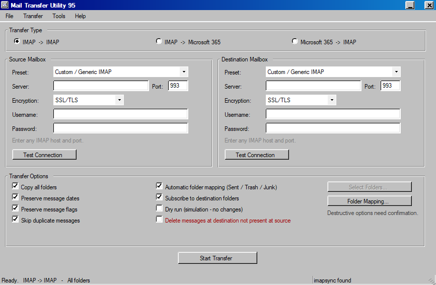
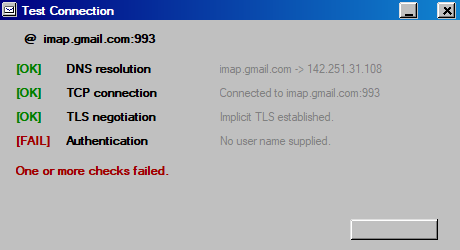
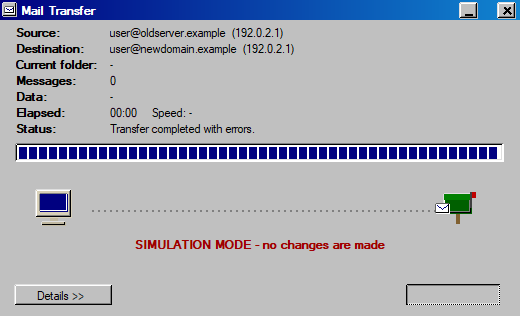
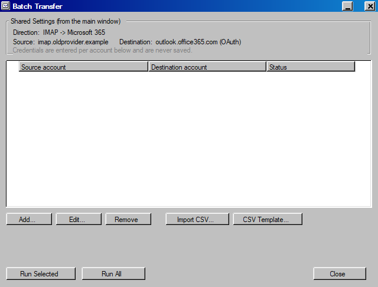
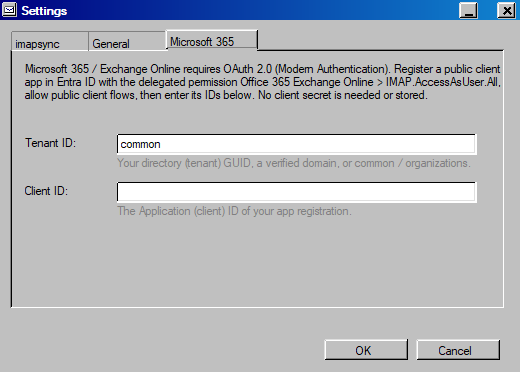
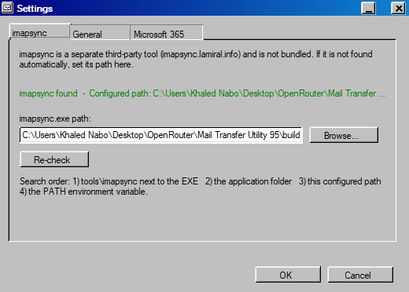

# Mail Transfer Utility 95

A standalone Windows desktop tool for **migrating and synchronizing mailboxes** between IMAP
servers and **Microsoft 365 / Exchange Online**. It is built for system administrators and IT
service providers, and it deliberately **looks like Windows 95** while behaving like a modern
Windows application — single-click controls, a normally draggable window, working
minimise/maximise/close and `Alt+F4`.

Mail Transfer Utility 95 is part of a small suite of Windows 95–style admin utilities
(alongside **VlanConfig95** and **DNS Toolbox 95**), but it is completely **standalone**: no
shared runtime, no services, just one small executable.

> Migrations move a lot of data. This tool **copies/synchronizes** mail and never deletes from
> the source by default. Always test with a non-production mailbox first and verify the
> destination before cut-over.



> The main window: choose a direction, configure the source and destination mailboxes, set
> options, and start the transfer.

---

## Requirements

- **Windows 10 or Windows 11**
- **.NET Framework 4.8** (ships in-box with supported Windows versions)
- **imapsync** for Windows — the transfer backend. It is a separate third-party project
  (<https://imapsync.lamiral.info/>) and is **not bundled**; point the app at your copy in
  *Tools → Configure imapsync…*
- **Network access** to the source and destination IMAP endpoints (TCP 993 / 143)
- For Microsoft 365: an **Entra ID app registration** (public client) with the delegated
  permission `IMAP.AccessAsUser.All`

---

## Features

### Transfer directions

Pick a direction and the source/destination panels reconfigure themselves automatically.
Microsoft 365 always uses OAuth — **never** Basic Authentication.

| Direction | Source auth | Destination auth |
|---|---|---|
| **IMAP → IMAP** | Username + password | Username + password |
| **IMAP → Microsoft 365** | Username + password | OAuth 2.0 (Modern Auth) |
| **Microsoft 365 → IMAP** | OAuth 2.0 (Modern Auth) | Username + password |

### Connection testing

Each endpoint has a **Test Connection** button that verifies the whole path without starting a
transfer. Results use the classic status markers:

- **`[OK]`** — the step succeeded (green)
- **`[FAIL]`** — the step failed (red); testing stops there



> DNS, TCP and TLS confirmed; the test stops at authentication. No credentials are sent until
> you supply them.

### Transfer progress

When a transfer runs, a classic Windows 95 copy dialog opens with a hand-drawn envelope
animation travelling from the source to the destination mailbox, live counters parsed from
imapsync, a `Details >>` pane with the raw (secret-free) output, and a working **Cancel**.



> Dry-run mode shows a prominent `SIMULATION MODE` banner. When the total is unknown the bar
> runs an honest indeterminate animation instead of faking a percentage.

### Batch migration (multiple accounts)

Configure the servers and options once, then run many mailboxes from one list. Add accounts by
hand or **import a CSV**; each mailbox runs through the same engine, one after another, with a
per-account status.



Batch row statuses: `Ready` → `Running…` → `Done` / `Simulated OK` / `Errors` / `Cancelled` /
`Skipped`. CSV columns are `SourceUser,SourcePassword,DestUser,DestPassword` (the destination
fields are optional). **Credentials in a batch live only in memory and are never saved.**

### Microsoft 365 (OAuth 2.0)

Microsoft 365 / Exchange Online requires Modern Authentication for IMAP. The app uses the
Microsoft identity platform **device-code flow**: you sign in on Microsoft's own page, so the
application never sees your Microsoft password and never stores a token on disk. Enter your
tenant and application (client) IDs once — no client secret is used or stored.



### Other

- **Saved jobs / profiles** (JSON) — connection settings and options, never passwords/tokens
- **Folder handling** — all folders, or a live **Select Folders…** subset
- **Folder mapping** — e.g. `Sent → Sent Items`, `Trash → Deleted Items`, with a one-click
  standard Exchange mapping; automatic mapping is on by default
- **Dry run** simulation, and careful gating of any destructive option
- **Migration report** with Copy Summary / Save Report and readable error translation
- **Optional logging** (off by default), the **imapsync** configuration, and a classic
  **About** box



---

## Privacy / Credential handling

- **No passwords on the command line.** Credentials are passed to imapsync via short-lived
  `--passfile` / `--oauthaccesstoken` files that are overwritten and deleted after the run, so
  the command preview contains no secrets.
- **Passwords are not stored by default.** You enter them per run. If you opt in when saving a
  job, they are protected with **Windows DPAPI** (current-user scope) — never plain text.
- **OAuth tokens are never written to disk.** They live only in memory for the session.
- **Saved jobs contain no secrets** (the serializer excludes the secret fields).
- **Logging is off by default** and never records passwords or tokens. Settings and jobs are
  stored under `%LocalAppData%\MailTransfer95`.

---

## Building

A dependency-free build using the in-box .NET Framework compiler (no Visual Studio, no .NET
SDK, no NuGet):

```powershell
powershell -ExecutionPolicy Bypass -File .\build.ps1 -Configuration Release
```

Or simply:

```powershell
.\build.cmd
```

The result is `build\MailTransfer95.exe`. The icon is generated automatically by
`tools\New-Icon.ps1` if `assets\app.ico` is missing.

For Visual Studio / MSBuild users:

```powershell
msbuild src\MailTransfer95.csproj /p:Configuration=Release
```

---

## How it works

- **`ImapSyncLocator` / `ImapSyncCommandBuilder` / `ImapSyncService`** — locate imapsync,
  build a correctly quoted, secret-free command, and run it asynchronously with cancellation.
- **`ConnectionTestService` / `FolderService`** — a minimal read-only IMAP client for the
  connection test and the folder picker (DNS → TCP → TLS → auth → mailbox).
- **`OAuthService`** — the Microsoft identity platform device-code flow (public client).
- **`TransferProgressParser` / `ReportService`** — parse imapsync output into live counters
  and a readable end-of-run report with exit-code translation.
- **`Settings` / `JobRepository` / `CredentialStore`** — preferences and saved jobs (JSON);
  opt-in credential storage via DPAPI.
- **`Win95*` / `Classic*`** — a fully owner-drawn Windows 95 UI toolkit (title bar, buttons,
  checkboxes, radios, list views, tabs and message boxes) so nothing modern leaks into the
  look.

---

## Disclaimer

This project is experimental software and is provided **as-is**. Mailbox migrations can affect
large amounts of data. Always test migrations with a non-production mailbox first and verify
the destination mailbox before cut-over.

The author and geissler-IT make no guarantees regarding correctness, compatibility or fitness
for a particular purpose and are not responsible for data loss, mail loss, service interruption
or other damage resulting from use of this software.

imapsync is a separate third-party project by Gilles Lamiral; this utility only acts as a front
end for it and claims no ownership of it.

This is a personal/experimental project and **not** an officially supported geissler-IT product
unless explicitly stated otherwise.

---

## Developer

**Khaled Nabo** — geissler-IT
